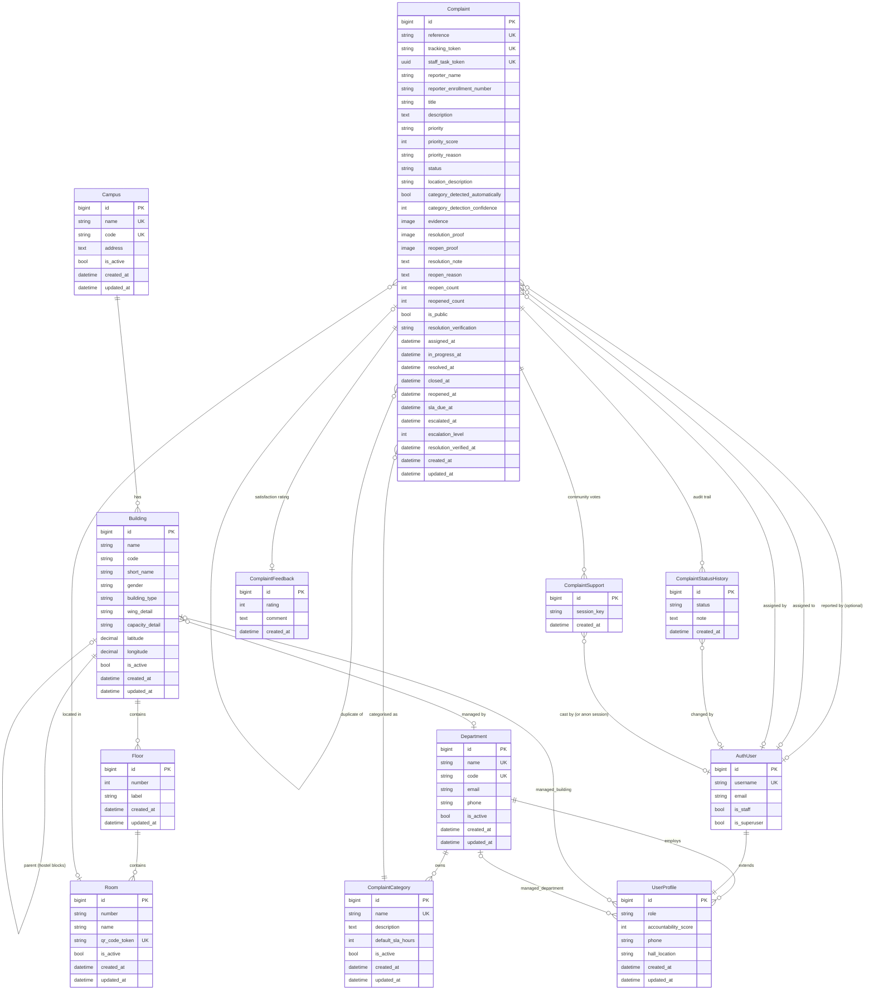
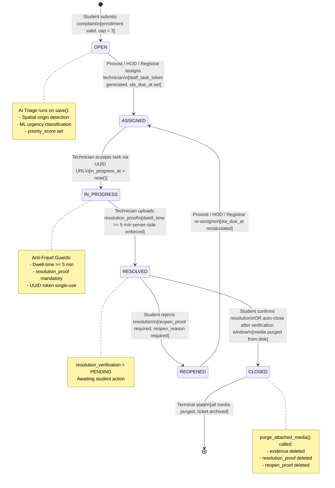
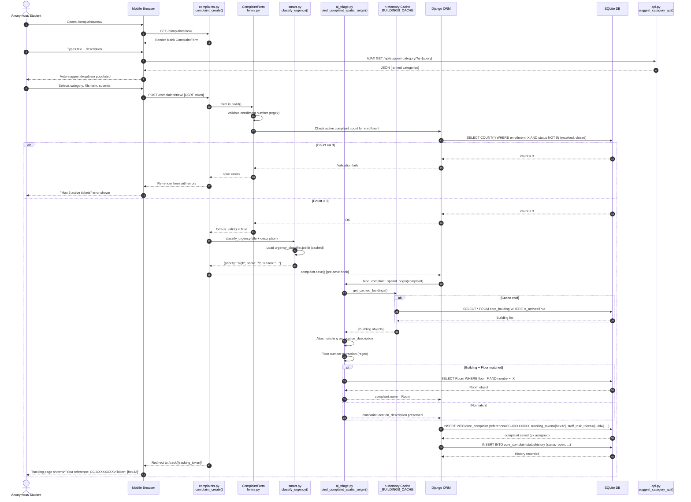
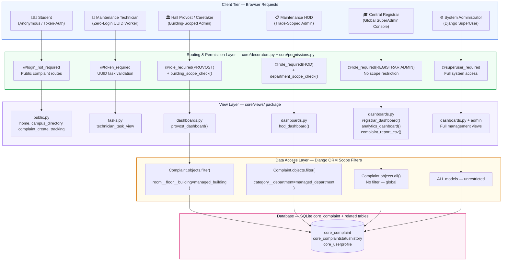
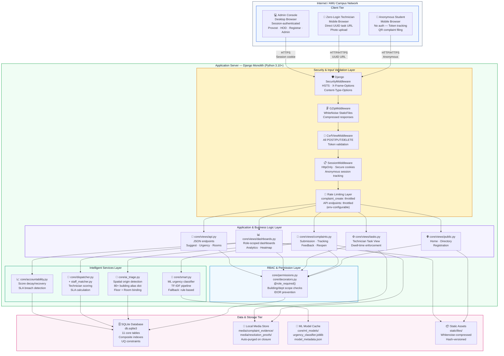

# CampusCare — Visual Architecture Diagrams

**Document ID:** CC-ARCH-2025-v1.0  
**Companion to:** `SRS.md` (CC-SRS-2025-v1.0)  
**Standard:** IEEE 830-1998 / ISO/IEC/IEEE 29148:2018 — Architecture Supplement  
**Date:** October 2025  

> All diagrams render in Antigravity IDE / VS Code Markdown Preview (Mermaid.js).  
> ASCII backups follow each diagram for terminal and plain-text compatibility.

---

## Table of Contents

1. [Diagram 1 — Entity-Relationship Diagram (ERD)](#diagram-1--entity-relationship-diagram-erd)
2. [Diagram 2 — Complaint Lifecycle State Machine](#diagram-2--complaint-lifecycle-state-machine)
3. [Diagram 3 — Sequence Diagram: Anonymous Complaint Submission & AI Triage](#diagram-3--sequence-diagram-anonymous-complaint-submission--ai-triage)
4. [Diagram 4 — RBAC Layered Architecture & Role Routing](#diagram-4--rbac-layered-architecture--role-routing)
5. [Diagram 5 — High-Level Architecture & Security Boundary](#diagram-5--high-level-architecture--security-boundary)
6. [Diagram 6 — UML Use Case Diagram](#diagram-6--uml-use-case-diagram)

---

## Diagram 1 — Entity-Relationship Diagram (ERD)

This ERD captures the complete CampusCare data model as defined in `core/models.py`, including all foreign keys, self-referencing hierarchies, unique constraints, and audit trail relationships. It is the authoritative structural reference for database migration scripts and API design.



**ASCII Backup:**

```
┌─────────┐    ┌──────────┐    ┌───────┐    ┌──────┐
│ Campus  │1──*│ Building │1──*│ Floor │1──*│ Room │
└─────────┘    └──┬───────┘    └───────┘    └──┬───┘
                  │ (self-FK: parent)           │
                  │ ┌──────────────────────┐    │
                  └─┤ Constituent Hostel   │    │
                    └──────────────────────┘    │
                                                │
┌────────────┐    ┌──────────────────┐         │
│ Department │1──*│ ComplaintCategory│         │
└────┬───────┘    └────────┬─────────┘         │
     │                     │                   │
     │         ┌───────────▼───────────────────▼──┐
     │         │           Complaint               │
     │         │  reference UK | tracking_token UK │
     │         │  staff_task_token (UUID) UK        │
     │         │  priority | status | sla_due_at    │
     │         │  resolution_verification           │
     │         └───┬───────────────────────────────┘
     │             │
     │    ┌────────▼──────────────────────────────────┐
     │    │  ComplaintStatusHistory  ComplaintSupport  │
     │    │  ComplaintFeedback (1:1)                   │
     │    └───────────────────────────────────────────┘
     │
┌────▼───────────┐    ┌──────────┐
│ UserProfile    │────│ AuthUser │
│ role           │    └──────────┘
│ managed_bldg   │
│ accountability │
└────────────────┘
```

---

## Diagram 2 — Complaint Lifecycle State Machine

This state machine defines all valid transitions for `Complaint.status`, including guards (role and proof requirements), anti-fraud controls (dwell-time), and the resolution verification loop. It is the authoritative reference for all status-transition business logic in `core/views/complaints.py` and `core/views/tasks.py`.



**ASCII Backup:**

```
                    [Student Submits]
                    enrollment valid
                    cap < 3 tickets
                          │
                          ▼
                       ┌──────┐
                       │ OPEN │ ◄─────────────────────────┐
                       └──┬───┘                            │
                          │ Provost/HOD/Registrar assigns  │
                          │ sla_due_at = now + SLA hours   │
                          ▼                                │
                     ┌──────────┐                         │
                     │ ASSIGNED │                         │
                     └────┬─────┘                         │
                          │ Technician accepts UUID URL    │
                          │ in_progress_at = now()        │
                          ▼                                │
                   ┌─────────────┐                        │
                   │ IN_PROGRESS │                        │
                   └──────┬──────┘                        │
                          │ Technician uploads proof       │
                          │ dwell_time >= 5min (enforced) │
                          ▼                                │
                     ┌──────────┐   Student rejects       │
                     │ RESOLVED │ ─────────────────────► ┌──────────┐
                     └────┬─────┘   reopen_proof required│ REOPENED │
                          │                               └────┬─────┘
                 Student confirms                              │ Re-assigned
                 OR auto-close                                 └─────────────┘
                          │
                          ▼
                      ┌────────┐
                      │ CLOSED │ ──► media purged from disk ──► [*]
                      └────────┘
```

---

## Diagram 3 — Sequence Diagram: Anonymous Complaint Submission & AI Triage

This sequence diagram traces the complete request lifecycle from a student's form submission through the AI triage pipeline, ML urgency classification, database persistence, and tracking token delivery. It documents the integration points between `core/views/complaints.py`, `core/ai_triage.py`, `core/smart.py`, and the Django ORM.



**ASCII Backup:**

```
Student   Browser   ComplaintView   Form   SmartPy   AiTriage   Cache   DB
  │          │            │           │        │          │         │      │
  │──GET /complaints/new/─►           │        │          │         │      │
  │          │            │──render form──────►│          │         │      │
  │──types, submits POST ─►           │        │          │         │      │
  │          │            │──is_valid()────────►           │         │      │
  │          │            │           │──regex check───────────────────────►│
  │          │            │           │──count check──────────────────────►DB
  │          │            │           │◄─count < 3 ──────────────────────DB│
  │          │            │──classify_urgency()──►        │         │      │
  │          │            │◄─{priority, score}───SmartPy  │         │      │
  │          │            │──complaint.save() ──►          │         │      │
  │          │            │                    ─bind_spatial()──────►      │
  │          │            │                               │──cache?──►Cache│
  │          │            │                               │          │──DB►│
  │          │            │                               │◄─buildings─────│
  │          │            │                               │──alias match    │
  │          │            │──INSERT Complaint ─────────────────────────────►│
  │          │            │──INSERT StatusHistory──────────────────────────►│
  │          │◄──redirect /track/[token]/─────────────────                  │
  │◄─tracking page shown─ │                                                 │
```

---

## Diagram 4 — RBAC Layered Architecture & Role Routing

This diagram maps the six CampusCare user roles to their corresponding view layers, permission decorators, and data access scopes. It documents how `core/permissions.py`, `core/decorators.py`, and `core/views/dashboards.py` cooperate to enforce the multi-tenant access control model, preventing IDOR and privilege escalation.



**ASCII Backup:**

```
┌─────────────────────────────────────────────────────────────────────┐
│ ACTOR         AUTH METHOD         SCOPE FILTER      DATA ACCESS      │
├─────────────────────────────────────────────────────────────────────┤
│ Student       None (anon)         Own token only    Submit + Track   │
│ Technician    UUID task token     Single complaint  Accept + Resolve │
│ Provost       Session + password  managed_building  Hall complaints  │
│ HOD           Session + password  managed_dept      Dept complaints  │
│ Registrar     Session + password  None (global)     All complaints   │
│ Admin         Superuser           None (global)     All + user mgmt  │
└─────────────────────────────────────────────────────────────────────┘

IDOR Prevention:
  Provost: ORM filter → room__floor__building = managed_building
  HOD:     ORM filter → category__department = managed_department
  (Not template-level — enforced at query level)
```

---

## Diagram 5 — High-Level Architecture & Security Boundary

This C4-inspired diagram illustrates the three-tier architecture of CampusCare — Client, Application/Middleware, and Data/Storage — along with the security perimeters, middleware stack, and the intelligent services layer. It serves as the deployment and security review reference for the system's monolithic Django architecture.



**ASCII Backup:**

```
╔══════════════════════════════════════════════════════════════════════════════╗
║  AMU CAMPUS NETWORK                                                          ║
║  ┌─────────────┐  ┌─────────────────┐  ┌──────────────────────────────┐    ║
║  │ Anon Student│  │  Technician     │  │  Admin Console               │    ║
║  │ Mobile      │  │  UUID task URL  │  │  Provost/HOD/Registrar/Admin  │    ║
║  └──────┬──────┘  └────────┬────────┘  └──────────────┬───────────────┘    ║
║         │                  │                           │                     ║
║         └──────────────────┴───────────────────────────┘                    ║
║                               HTTP/HTTPS                                     ║
╠══════════════════════════════════════════════════════════════════════════════╣
║  APPLICATION SERVER — Django Monolith                                        ║
║  ┌─────────────────────────────────────────────────────────────────────┐    ║
║  │  SECURITY MIDDLEWARE STACK                                           │    ║
║  │  SecurityMiddleware → GZipMiddleware → CsrfViewMiddleware →         │    ║
║  │  SessionMiddleware → AuthMiddleware → RateLimiting                  │    ║
║  ├─────────────────────────────────────────────────────────────────────┤    ║
║  │  VIEW LAYER (core/views/)                                           │    ║
║  │  public.py  │ complaints.py  │ tasks.py  │ dashboards.py  │ api.py  │    ║
║  ├─────────────────────────────────────────────────────────────────────┤    ║
║  │  RBAC LAYER: core/permissions.py + core/decorators.py               │    ║
║  │  @role_required() → ORM scope filter → IDOR prevention              │    ║
║  ├─────────────────────────────────────────────────────────────────────┤    ║
║  │  INTELLIGENT SERVICES                                                │    ║
║  │  ai_triage.py  │  smart.py (TF-IDF ML)  │  dispatcher.py           │    ║
║  │  staff_matcher.py  │  accountability.py                             │    ║
║  └─────────────────────────────────────────────────────────────────────┘    ║
╠══════════════════════════════════════════════════════════════════════════════╣
║  DATA & STORAGE TIER                                                         ║
║  ┌────────────────┐  ┌────────────────────┐  ┌────────────────────────┐    ║
║  │  SQLite DB     │  │  Media Storage     │  │  ML Model Cache        │    ║
║  │  db.sqlite3    │  │  complaint_evidence│  │  urgency_classifier    │    ║
║  │  11 tables     │  │  resolution_proofs │  │  .joblib               │    ║
║  │  4 comp. idx   │  │  (purged on close) │  │  model_metadata.json   │    ║
║  └────────────────┘  └────────────────────┘  └────────────────────────┘    ║
╚══════════════════════════════════════════════════════════════════════════════╝
```

---

## Diagram 6 — UML 2.5 Use Case Diagram

This UML 2.5 Use Case diagram models the system boundary and behavioral goals of the **AMU CampusCare Facility Maintenance Platform**. The diagram formalizes interactions across the **5 verified operational actor roles**, delineating primary actors (initiating interaction on the client side) from secondary/administrative authorities (supervisory governance), with strict separation of internal sub-processes.

```mermaid
graph TB
    subgraph CampusCare_System["System Boundary: AMU CampusCare Facility Maintenance Platform"]
        direction TB

        subgraph Sub_Student["Citizen & Student Services"]
            direction LR
            UC_Lodge(["Lodge Maintenance Complaint"])
            UC_Track(["Track Ticket Status via Token"])
            UC_Confirm(["Confirm Resolution & Purge Media"])
            UC_Reopen(["Dispute & Reopen Ticket with Proof"])
            UC_Feedback(["Submit Resolution Feedback & Rating"])
            UC_Browse(["Browse Public Issue Board & Directory"])
            UC_Upvote(["Upvote Public Issue Support"])
        end

        subgraph Sub_Shared["Automated Platform Sub-Processes (Included / Extended)"]
            direction LR
            UC_Quota(["Verify Active Ticket Quota & Enrollment"])
            UC_Triage(["Classify ML Urgency & Spatial Origin"])
            UC_QR(["Auto-Fill Room Data via QR Code"])
            UC_Dwell(["Validate Anti-Fraud 5-Min Dwell Timer"])
            UC_Matcher(["Suggest Optimal Staff via Least-Load Matcher"])
        end

        subgraph Sub_Tech["Technician Operations (Zero-Login)"]
            direction LR
            UC_AccessTask(["Access Dispatched Task via UUID URL"])
            UC_AcceptTask(["Accept Task & Start Work"])
            UC_UploadProof(["Upload Photographic Resolution Proof"])
        end

        subgraph Sub_Admin["Administrative Governance & Oversight"]
            direction LR
            UC_ManageHall(["Manage Hall Queue (Building-Scoped)"])
            UC_ManageDept(["Manage Department Queue (Trade-Scoped)"])
            UC_Dispatch(["Dispatch & Assign Technician"])
            UC_SLA(["Monitor SLA Targets & Staff Accountability"])
            UC_Analytics(["Inspect University Heatmap & Analytics"])
            UC_Export(["Export University-Wide Audit Logs"])
        end

        Sub_Student ~~~ Sub_Shared
        Sub_Shared ~~~ Sub_Tech
        Sub_Tech ~~~ Sub_Admin
    end

    %% Human Actors OUTSIDE System Boundary (UML 2.5 Strict)
    Student["🧑‍🎓 Student<br/>(Anonymous / Token-Authenticated)"]
    Technician["🔧 Maintenance Technician<br/>(Zero-Login Staff)"]
    Provost["🏛️ Hall Provost / Caretaker<br/>(Building-Scoped Admin)"]
    HOD["📋 Maintenance HOD<br/>(Trade-Scoped Admin)"]
    Registrar["🎓 Central Registrar<br/>(Global SuperAdmin Console)"]

    %% Primary Actor Associations (Solid Lines)
    Student --- UC_Lodge
    Student --- UC_Track
    Student --- UC_Confirm
    Student --- UC_Feedback
    Student --- UC_Browse

    Technician --- UC_AccessTask
    Technician --- UC_AcceptTask
    Technician --- UC_UploadProof

    %% Governance Actor Associations (Solid Lines)
    UC_ManageHall --- Provost
    UC_Dispatch --- Provost
    UC_SLA --- Provost

    UC_ManageDept --- HOD
    UC_Dispatch --- HOD
    UC_SLA --- HOD

    UC_Analytics --- Registrar
    UC_Export --- Registrar
    UC_Dispatch --- Registrar
    UC_SLA --- Registrar

    %% UML <<include>> Dependencies (Base -.-> Included)
    UC_Lodge -.->|&laquo;include&raquo;| UC_Quota
    UC_Lodge -.->|&laquo;include&raquo;| UC_Triage
    UC_UploadProof -.->|&laquo;include&raquo;| UC_Dwell
    UC_Dispatch -.->|&laquo;include&raquo;| UC_Matcher

    %% UML <<extend>> Dependencies (Extension -.-> Base)
    UC_QR -.->|&laquo;extend&raquo;| UC_Lodge
    UC_Reopen -.->|&laquo;extend&raquo;| UC_Confirm
    UC_Upvote -.->|&laquo;extend&raquo;| UC_Browse

    %% Strict UML 2.5 Styling
    style CampusCare_System fill:#f8fafc,stroke:#0f172a,stroke-width:2px
    style Sub_Student fill:#f0fdf4,stroke:#16a34a,stroke-width:1px
    style Sub_Shared fill:#f5f3ff,stroke:#7c3aed,stroke-width:1px
    style Sub_Tech fill:#fffbeb,stroke:#d97706,stroke-width:1px
    style Sub_Admin fill:#eff6ff,stroke:#2563eb,stroke-width:1px

    style Student fill:#e0f2fe,stroke:#0284c7,stroke-width:1.5px
    style Technician fill:#fef3c7,stroke:#d97706,stroke-width:1.5px
    style Provost fill:#f3e8ff,stroke:#9333ea,stroke-width:1.5px
    style HOD fill:#fce7f3,stroke:#db2777,stroke-width:1.5px
    style Registrar fill:#dcfce7,stroke:#16a34a,stroke-width:1.5px
```



**ASCII Backup:**

```
╔═══════════════════════════════════════════════════════════════════════════════════════════════╗
║                      CAMPUSCARE SYSTEM BOUNDARY: USE CASE ARCHITECTURE                        ║
╠═══════════════════════════════════════════════════════════════════════════════════════════════╣
║  PRIMARY ACTORS (Left)                   SYSTEM BOUNDARY USE CASES                            ║
║                                                                                               ║
║  🧑‍🎓 STUDENT ──────────────────────────► (Lodge Maintenance Complaint)                        ║
║     (Anonymous / Token-Auth)             │                                                    ║
║                                          ├──<<include>>──► (Verify Active Ticket Quota)       ║
║                                          ├──<<include>>──► (Classify ML Urgency & Spatial)    ║
║                                          ▲                                                    ║
║                                          └──<<extend>>──── (Auto-Fill Room via QR Code)       ║
║                                                                                               ║
║                                ───────► (Track Ticket Status via Hex32 Token)                 ║
║                                ───────► (Confirm Resolution & Purge Media)                    ║
║                                          ▲                                                    ║
║                                          └──<<extend>>──── (Dispute & Reopen Ticket with Proof)║
║                                ───────► (Submit Resolution Feedback & Rating)                 ║
║                                ───────► (Browse Public Issue Board & Directory)               ║
║                                          ▲                                                    ║
║                                          └──<<extend>>──── (Upvote Public Issue Support)      ║
║                                                                                               ║
║  🔧 TECHNICIAN ──────────────────────► (Access Dispatched Task via Direct UUID URL)           ║
║     (Zero-Login Staff)         ───────► (Accept Task & Transition to In-Progress)             ║
║                                ───────► (Upload Photographic Resolution Proof)                ║
║                                          └──<<include>>──► (Validate Anti-Fraud 5-Min Dwell)  ║
╠═══════════════════════════════════════════════════════════════════════════════════════════════╣
║  SECONDARY / GOVERNANCE ACTORS (Right)   ADMINISTRATIVE USE CASES                             ║
║                                                                                               ║
║  🏛️ HALL PROVOST / CARETAKER ◄─────── (Manage Hall Queue - Building Scoped)                  ║
║     (Building Scoped Admin)    ◄─────── (Dispatch & Assign Technician to Ticket)              ║
║                                          └──<<include>>──► (Suggest Optimal Staff via Matcher)║
║                                ◄─────── (Monitor SLA Targets & Staff Accountability)          ║
║                                                                                               ║
║  📋 MAINTENANCE HOD ───────────◄─────── (Manage Department Queue - Trade Scoped)              ║
║     (Trade Scoped Admin)       ◄─────── (Dispatch & Assign Technician to Ticket)              ║
║                                ◄─────── (Monitor SLA Targets & Staff Accountability)          ║
║                                                                                               ║
║  🎓 CENTRAL REGISTRAR ─────────◄─────── (Inspect University Heatmap & Spatial Analytics)      ║
║     (Global SuperAdmin)        ◄─────── (Export University-Wide Audit Logs CSV)               ║
║                                ◄─────── (Dispatch & Assign Technician to Ticket)              ║
║                                ◄─────── (Monitor SLA Targets & Staff Accountability)          ║
╚═══════════════════════════════════════════════════════════════════════════════════════════════╝
```

---

## Architectural Summary

| Diagram | Purpose | Key Insight |
|---|---|---|
| ERD | Database structure | 11 entities; self-referencing Building for hostel blocks; dual-token design on Complaint |
| State Machine | Lifecycle control | 6 states; dwell-time + proof guards on critical transitions; media purge on closure |
| Sequence | Request flow | AI triage runs inline on `Complaint.save()`; ML classification precedes ORM write |
| RBAC | Access control | ORM-level scope filtering (not template-level) prevents IDOR; 6 distinct role tiers |
| Architecture | System boundaries | Single-server monolith; local ML inference; no external API dependencies; 3-tier storage |
| Use Case | System behavior & user roles | 5 operational actor tiers; strict system boundary containment; formal `<<include>>` and `<<extend>>` semantics |

---

*End of CampusCare Architecture Diagrams*  
*Document ID: CC-ARCH-2025-v1.0 | Companion to CC-SRS-2025-v1.0*
